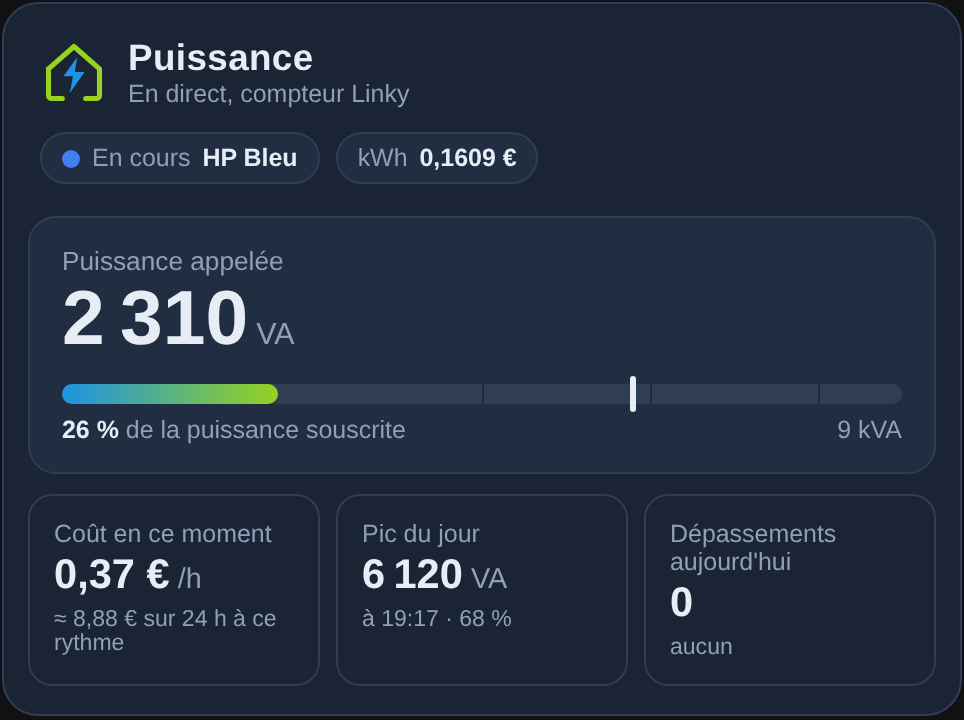
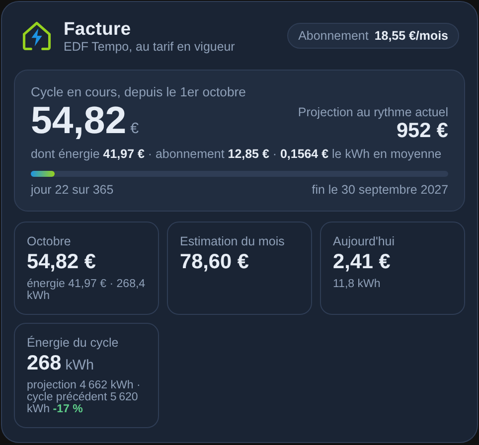
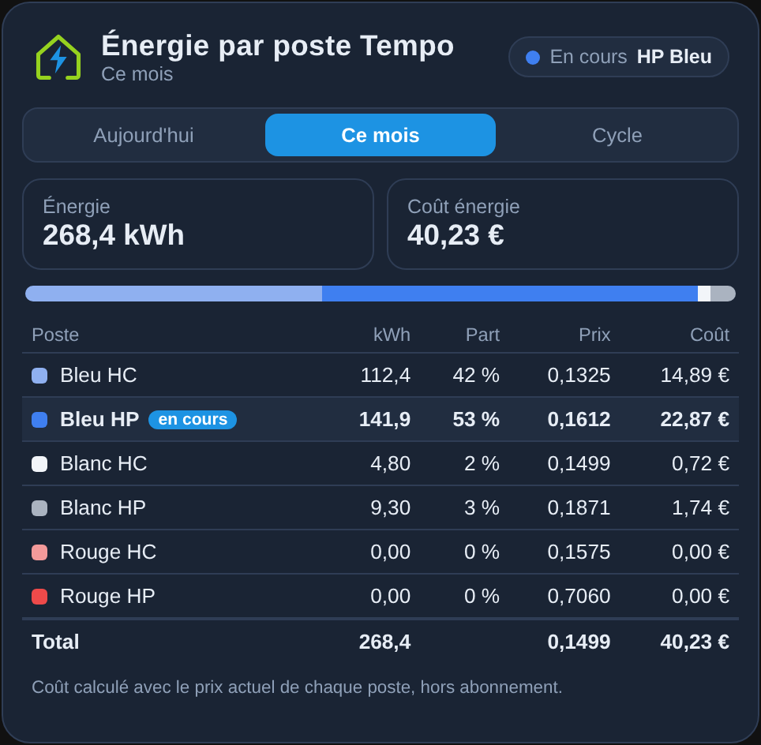
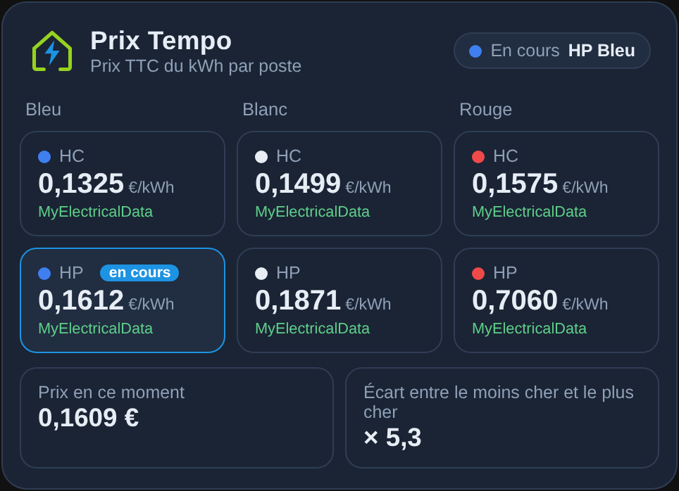
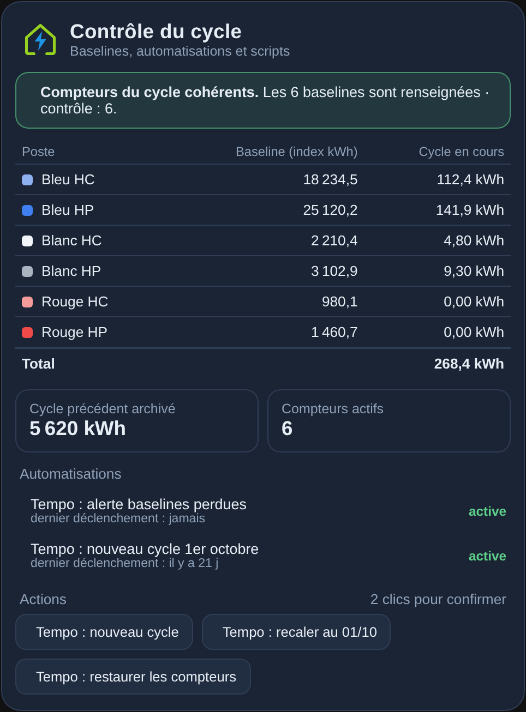
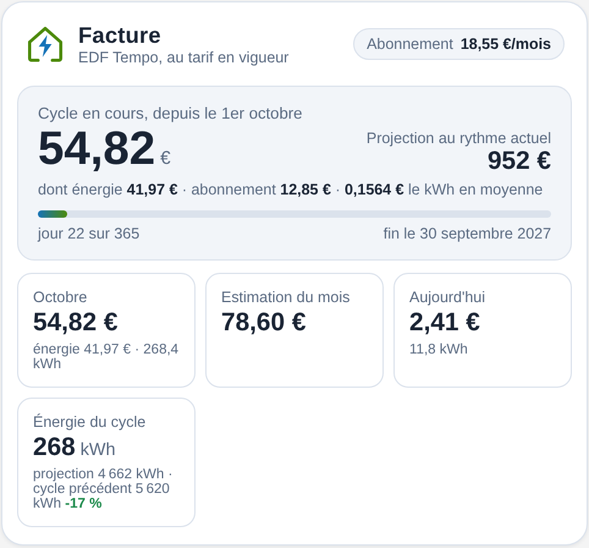

<p>
  ☕ <strong>Si cette carte vous est utile, vous pouvez soutenir le projet :</strong>
</p>

<div style="white-space: nowrap; line-height: 0;">
  <a
    href="https://www.buymeacoffee.com/Marlboro62"
    target="_blank"
    rel="noopener noreferrer"
    style="display: inline-block; text-decoration: none; vertical-align: middle;"
  ></a>&nbsp;&nbsp;<a
    href="https://ko-fi.com/M4M2QL45X"
    target="_blank"
    rel="noopener noreferrer"
    style="display: inline-block; text-decoration: none; vertical-align: middle;"
  ></a>
</div>


# Cartes Linky Énergie

**Six cartes Lovelace indépendantes, dans un seul fichier**, pour suivre l'énergie d'un contrat **EDF Tempo** dans Home Assistant, et l'état des services Enedis. Elles ont le style des cartes MyElectricalData new ([Carte Enedis Linky New](https://github.com/Marlboro62/content-card-linky-new)) : thème bleu nuit, version claire, ou thème Home Assistant.

Une seule ressource à installer, puis chaque carte s'ajoute où vous voulez avec son propre type. Elles ne remplacent aucune autre carte.

**[▶ Essayer la démo en ligne](https://marlboro62.github.io/linky-energie-cards/docs/demo.html)** : les 6 cartes avec des données simulées, thèmes clair et sombre, dépassement de puissance, écart de prix, compteurs incohérents, incident Enedis… et la configuration YAML à copier.

| Type | Carte |
| --- | --- |
| `custom:linky-puissance-card` | **Puissance** : puissance appelée sur la puissance souscrite, coût en ce moment, pic et dépassements du jour |
| `custom:linky-facture-card` | **Facture** : coût du cycle de facturation, projection, mois en cours, estimation, comparaison avec le cycle précédent |
| `custom:linky-tempo-postes-card` | **Énergie par poste Tempo** : kWh, part, prix et coût des 6 postes, aujourd'hui, ce mois ou sur le cycle |
| `custom:linky-tempo-prix-card` | **Prix Tempo** : prix TTC des 6 postes, poste en cours et vérification de la source des prix |
| `custom:linky-cycle-card` | **Contrôle du cycle** : baselines des compteurs, automatisations et scripts de maintenance |
| `custom:linky-enedis-status-card` | **État des services Enedis** : API Data Connect en service ou indisponibles, incident en cours (bêta) |

| Puissance | Facture | Énergie par poste |
| --- | --- | --- |
|  |  |  |

| Prix Tempo | Contrôle du cycle | Facture (clair) |
| --- | --- | --- |
|  |  |  |

*Aperçus réalisés avec des valeurs fictives.*

## Installation

### Avec HACS (recommandé)

1. Dans HACS, menu **⋮** → **Dépôts personnalisés**.
2. Ajoutez `https://github.com/Marlboro62/linky-energie-cards` avec le type **Tableau de bord** (Dashboard).
3. Cherchez **Cartes Linky Énergie**, installez, puis rechargez la page (Ctrl+F5).

### Manuellement

1. Téléchargez [`linky-energie-cards.js`](https://raw.githubusercontent.com/Marlboro62/linky-energie-cards/main/linky-energie-cards.js) (clic droit → Enregistrer sous) et copiez-le dans `/config/www/`.
2. **Paramètres → Tableaux de bord → ⋮ → Ressources → Ajouter une ressource** : URL `/local/linky-energie-cards.js`, type **Module JavaScript**.
3. Rechargez la page (Ctrl+F5).

## Capteurs

Les cartes **ne calculent pas les coûts elles-mêmes** : elles affichent des capteurs que vous avez déjà, par exemple avec un module TIC (Lixee / ZLinky), des `utility_meter` par poste Tempo et des capteurs template de coût.

Chaque option a une **valeur par défaut** qui correspond à un paquet Tempo courant (`sensor.lixee_*`, `sensor.tempo_*`, `sensor.conso_*`…). Si vos entités ont d'autres noms, changez-les dans l'**éditeur visuel** ou en YAML. Un élément dont le capteur n'existe pas est simplement masqué.

Les postes Tempo sont repérés par `bleu_hc`, `bleu_hp`, `blanc_hc`, `blanc_hp`, `rouge_hc`, `rouge_hp`. Pour les cartes qui lisent les 6 postes, on indique un **préfixe** et un **suffixe** : `sensor.tempo_` + `bleu_hc` + `_energie_ce_mois`.

Toutes les cartes acceptent `title` et `theme` (`v2` bleu nuit MyElectricalData, `auto` clair ou sombre selon Home Assistant, `ha` thème Home Assistant).

### Puissance — `custom:linky-puissance-card`

| Option | Rôle | Défaut |
| --- | --- | --- |
| `power` | Puissance instantanée (VA ou W) | `sensor.lixee_sinsts` |
| `subscribed` | Puissance souscrite (kVA ou VA) | `sensor.lixee_pref` |
| `tarif` | Poste en cours, texte du type « HP BLEU » | `sensor.lixee_current_price` |
| `price` | Prix du kWh en cours | `sensor.tempo_tarif_ttc_actuel` |
| `cost_rate` | Coût instantané (€/h). Sans lui, estimé avec puissance × prix | `sensor.tempo_total_instantane` |
| `overrun` | Dépassement en cours (`binary_sensor`) | `binary_sensor.linky_depassement_puissance` |
| `overruns_day` | Nombre de dépassements du jour | `sensor.linky_depassements_jour` |
| `show_peak` | Pic du jour, lu dans les statistiques de Home Assistant | `true` |

La jauge passe à l'orange à 70 % et au rouge à 90 % de la puissance souscrite. Un dépassement en cours affiche une alerte.

### Facture — `custom:linky-facture-card`

| Option | Rôle | Défaut |
| --- | --- | --- |
| `cycle_start` | Début du cycle de facturation, `MM-JJ` | `10-01` |
| `cost_cycle` / `energy_cycle` | Coût total / coût énergie du cycle | `sensor.tempo_cout_total_cycle_en_cours` / `sensor.tempo_cout_energie_cycle_en_cours` |
| `cost_month` / `energy_month` | Coût total / énergie du mois | `sensor.tempo_cout_total_ce_mois` / `sensor.tempo_cout_energie_ce_mois` |
| `cost_day` | Coût total aujourd'hui | `sensor.tempo_cout_total_aujourd_hui` |
| `estimate_month` | Estimation du mois | `sensor.edf_estimation_mensuelle` |
| `subscription_month` | Abonnement mensuel | `input_number.abonnement_mensuel_tempo` |
| `kwh_cycle` / `kwh_prev_cycle` | Énergie du cycle / du cycle précédent | `sensor.conso_totale_cycle_en_cours` / `sensor.conso_cycle_precedent_archive` |
| `kwh_month` / `kwh_day` | Énergie du mois / du jour | `sensor.conso_totale_mensuelle` / `sensor.tempo_consommation_totale_aujourd_hui` |
| `budget_month` | Budget mensuel en €, comparé à l'estimation (facultatif) | — |

La **projection** ramène le coût du cycle à 365 jours **au rythme actuel**. Elle n'anticipe ni l'hiver ni les jours rouges : en début de cycle, elle sous-estime donc la facture d'un logement chauffé à l'électricité.

### Énergie par poste Tempo — `custom:linky-tempo-postes-card`

| Option | Rôle | Défaut |
| --- | --- | --- |
| `period` | Onglet ouvert au chargement : `jour`, `mois` ou `cycle` | `mois` |
| `prefix` | Préfixe des capteurs d'énergie | `sensor.tempo_` |
| `suffix_day` / `suffix_month` / `suffix_cycle` | Suffixes par période | `_energie_aujourdhui` / `_energie_ce_mois` / `_energie_cette_annee` |
| `price_prefix` | Préfixe des prix par poste | `sensor.tempo_prix_` |
| `tarif` | Poste en cours (mis en évidence) | `sensor.lixee_current_price` |

Le coût affiché est l'énergie du poste multipliée par son **prix actuel**, hors abonnement.

### Prix Tempo — `custom:linky-tempo-prix-card`

| Option | Rôle | Défaut |
| --- | --- | --- |
| `price_prefix` | Prix utilisés par vos calculs (`<couleur>_<hc\|hp>`) | `sensor.tempo_prix_` |
| `source_prefix` | Prix publiés par MyElectricalData (`<blue\|white\|red>_<hc\|hp>`) | `sensor.myelectricaldata_tempo_price_` |
| `fallback_prefix` | Prix de secours | `input_number.tempo_tarif_` |
| `current` | Prix du kWh en cours | `sensor.tempo_tarif_ttc_actuel` |
| `tarif` | Poste en cours | `sensor.lixee_current_price` |

Sous chaque prix, la carte indique sa source : **MyElectricalData**, **valeur de secours** ou **autre source**. Elle affiche une alerte si la source MyElectricalData est indisponible ou si elle diffère de la valeur de secours, ce qui signale en général un changement de tarif à reporter.

### Contrôle du cycle — `custom:linky-cycle-card`

| Option | Rôle | Défaut |
| --- | --- | --- |
| `control` | Nombre de compteurs actifs | `sensor.tempo_controle_compteurs_actifs` |
| `baseline_prefix` | Baselines (index au début du cycle) | `input_number.baseline_` |
| `cycle_prefix` / `cycle_suffix` | Compteurs du cycle par poste | `sensor.conso_` / `_cycle_en_cours` |
| `total` | Énergie totale du cycle | `sensor.conso_totale_cycle_en_cours` |
| `archive` | Énergie du cycle précédent archivée | `input_number.archive_conso_cycle_precedent` |
| `cycle_start` | Début du cycle (`MM-JJ`), pour comparer les compteurs au mois | `10-01` |
| `month_prefix` / `month_suffix` | Compteurs du mois par poste | `sensor.tempo_` / `_energie_ce_mois` |
| `scripts` | Scripts proposés en boutons | `script.tempo_recaler_cycle_01_10`, `script.tempo_restaurer_compteurs` |
| `automations` | Automatisations surveillées | `automation.tempo_alerte_baselines_perdues`, `automation.tempo_nouveau_cycle_de_facturation_1er_octobre` |

La carte signale une baseline à 0 ou introuvable et un compteur de cycle négatif. Pendant le **premier mois du cycle** (cycle commençant le 1er), elle compare aussi chaque compteur du cycle à celui du mois : ils doivent être égaux, et un écart d'au moins 0,5 kWh révèle en général une baseline mal réglée. La valeur de `control` est affichée telle quelle. Le script de **nouveau cycle** n'est pas proposé par défaut : il remet le cycle à zéro et écrase l'archive, et l'automatisation du début de cycle le lance déjà. Ne l'ajoutez à `scripts:` qu'en connaissance de cause. Les boutons de scripts demandent une **confirmation en deux clics** (« Confirmer ? » pendant 5 secondes), car ces scripts modifient les compteurs.

Un exemple avec les 5 cartes est dans [`exemples/cartes-energie.yaml`](exemples/cartes-energie.yaml).

### État des services Enedis — `custom:linky-enedis-status-card`

Affiche l'état des API **Enedis Data Connect de production**, celles qu'utilisent MyElectricalData et sa passerelle, tel que publié sur la page [État des services](https://datahub-enedis.fr/services-api/etat-des-services/) d'Enedis DataHub. Quand un service est indisponible, la carte affiche un bandeau « Incident Enedis en cours » : inutile alors de réinstaller ou de relancer MyElectricalData, les données reprendront seules.

| Option | Rôle | Défaut |
| --- | --- | --- |
| `prefix` | Préfixe des capteurs d'état | `sensor.enedis_datahub_` |
| `show_roles` | Rôle de chaque service sous son nom | `true` |
| `show_link` | Lien vers la page Enedis | `true` |

**Capteurs : intégration Scrape.** Un navigateur ne peut pas lire la page Enedis directement : Home Assistant la lit avec l'intégration native **Scrape**, sans code ni YAML.

1. **Paramètres → Appareils et services → Ajouter une intégration → Scrape**.
2. Ressource : `https://datahub-enedis.fr/services-api/etat-des-services/`, méthode `GET` (délai : 30 s).
3. Ajoutez un capteur par service. Le sélecteur est toujours `.status-api` et l'attribut est `data-status` (dans les options avancées) :

   | Nom du capteur | Index |
   | --- | --- |
   | `Enedis DataHub Authorize` | 8 |
   | `Enedis DataHub Services souscrits` | 9 |
   | `Enedis DataHub Mesures` | 10 |
   | `Enedis DataHub Données générales` | 11 |
   | `Enedis DataHub Alimentation` | 12 |
   | `Enedis DataHub Situation contractuelle` | 13 |
   | `Enedis DataHub Synthèse contractuelle` | 14 |
   | `Enedis DataHub Situation comptage` | 15 |

Chaque capteur vaut `up` ou `down`, et ses noms donnent les entités `sensor.enedis_datahub_…` que la carte trouve seule. Les index sont ceux de la page au 29/10/2026 (les index 0 à 7 sont l'environnement de test d'Enedis) : si Enedis réorganise sa page, par exemple au passage complet à Data Connect 2026, ils seront à ajuster.

```yaml
type: custom:linky-enedis-status-card
```

Les mêmes capteurs servent aussi à une automatisation, par exemple une notification quand `sensor.enedis_datahub_mesures` passe à `down`.

## Support

Questions et problèmes : uniquement via les [issues GitHub](https://github.com/Marlboro62/linky-energie-cards/issues).

## Voir aussi

[Carte Enedis Linky New](https://github.com/Marlboro62/content-card-linky-new) · [Carte Linky Appareils](https://github.com/Marlboro62/linky-appareils-card) · [Carte Linky Solaire](https://github.com/Marlboro62/linky-solaire-card) · [Carte Onduleur UPS](https://github.com/Marlboro62/onduleur-ups-card)

## Licence

MIT
